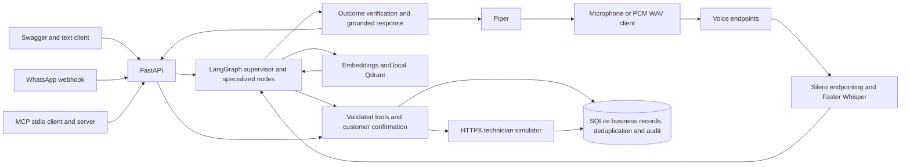

# System architecture

FastAPI authenticates the customer before passing their identity into the graph. A WhatsApp request is signed by Meta and mapped to a registered phone number. Voice uses the same JWT customer identity and chat engine as text. The supervisor emits bounded, typed intents. A specialist reads authoritative facts through a tool, retrieves policy snippets, or proposes a write. The customer must confirm an exact command before a write runs. Verification reads the resulting business state.

Business records and operation keys use transactions. Conversation checkpoints use a separate SQLite file and a customer-scoped thread ID. Stripe locks serialize writes for the same thread in one process and permit unrelated sessions to proceed concurrently. The graph consumes at most three classified intents per message and has a recursion limit. Run a single Uvicorn worker with local Qdrant and the process-local guards.

A business tool answers questions that depend on current customer state, such as a recharge status. Retrieval answers questions grounded in policy or troubleshooting instructions. A retrieved passage cannot change account state. Use a direct deterministic path for fixed API operations and a graph to coordinate heterogeneous requests and evidence.

## Voice and contact center concepts

PCM is a sequence of signed sample amplitudes. DishCare receives one channel at 16,000 samples per second, two bytes per sample. A 512-sample chunk spans 32 ms. Silero classifies each frame and the session keeps a short pre-roll to preserve the start of speech. About 608 ms of silence ends the utterance. Faster Whisper decodes the accumulated audio once. Piper selects a local English or Hindi voice and returns audio at its native sample rate.

HTTP handles one complete PCM turn at a time. WebSocket carries binary audio frames and control messages on a long-lived connection. The server transcribes each endpointed utterance and sends response metadata followed by one PCM message. An interrupt cancels the queued or active turn and resets the endpoint, while the client can stop playback. CPU inference already executing in a background thread may finish after cancellation. Confirmed business operations retain their normal transaction semantics.

WebRTC is suited to real-time media with transport-level jitter handling and congestion control. A SIP endpoint signals calls, while media typically flows over RTP. A PSTN gateway bridges the telephone network into a media server that would resample audio for ASR. An IVR can gather keypad or spoken choices. A human transfer would bridge the call and pass an authorized summary and reference to an agent. DishCare records a confirmed escalation ticket. Telephone routing and live transfer are conceptual.

## Observability and optimization

Request events log route templates, request IDs, status, duration and token usage without request content or credentials. A bounded in-memory sample window exposes P50, P95 and P99. Stage timings separate ASR, chat and TTS. Set a token price table for cost estimates. Costs are absent when attribution is incomplete. Metrics are per worker and reset on restart.

Cache bounded Qdrant results for repeated identical queries and clear them when rebuilding the index. Run independent read-only recharge lookups and retrieval concurrently. Keep writes serialized by their operation keys. Deterministic confirmation and injection paths skip model calls. Use model selection, prompt versions, and replay results together to decide whether a faster model or shorter prompt preserves task success.
